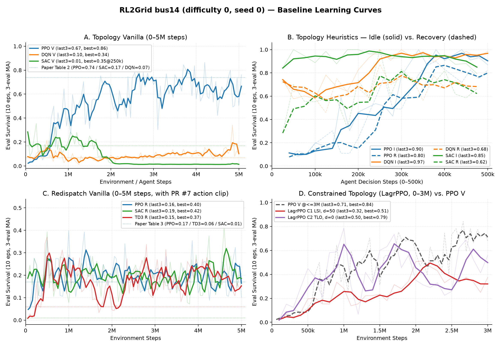
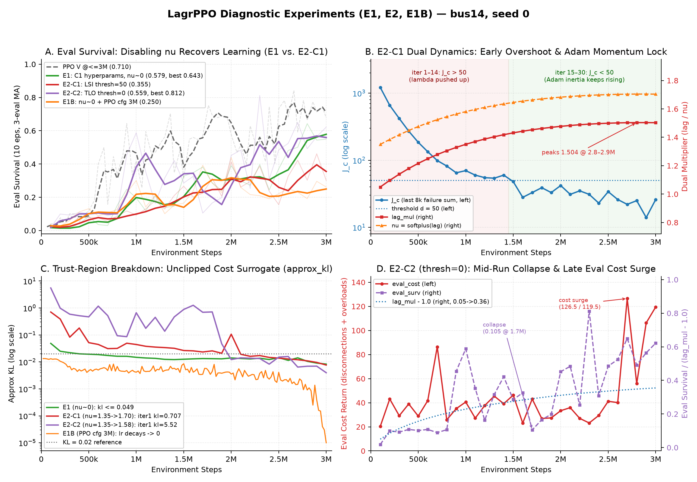

# RL2Grid 研究方向提案（Research Directions）

> 依據：bus14 seed 0 的 reproduction 結果（見 `reproduction_bus14_seed0.md`）、RL2Grid 原始碼，以及兩份主要參考資料：
> - **[P]** Marchesini et al., *RL2Grid: Benchmarking Reinforcement Learning in Power Grid Operations*, arXiv 2503.23101v2（下文以 [P §x] 標註章節）
> - **[S]** Bolei Zhou, *Intro to Reinforcement Learning* 投影片，[github.com/zhoubolei/introRL](https://github.com/zhoubolei/introRL)。下文以 [S Lx p.y] 標註第 x 講第 y 頁，點擊會開啟該講的 PDF；GitHub 的 PDF 檢視器無法直接跳頁，請自行翻到第 y 頁（頁碼和投影片右下角的「y / 總頁數」一致）。各頁的標題列在 [§7](#7-參考資料)。
>
> 標記說明：📄 論文寫的　🎓 投影片的公式　🔍 程式碼確認過的事實　📊 我們跑出來的數據　💭 推論／假設（需實驗驗證）
>
> **重要提醒**：目前只有 **1 個 seed**，評估之間的波動也大。下面的「觀察」都是要驗證的假設，不是結論。

---

## 目錄

1. [背景與符號](#1-背景與符號)
2. [Reproduction 結果摘要](#2-reproduction-結果摘要)
3. [觀察到的問題（O1–O8）](#3-觀察到的問題o1o8)
4. [研究方向（RD1–RD8）](#4-研究方向rd1rd8)
5. [優先順序與分工建議](#5-優先順序與分工建議)
6. [第一批建議實驗](#6-第一批建議實驗)
7. [參考資料](#7-參考資料)

---

## 1. 背景與符號

### 1.1 MDP、回報與價值函數

📄 [P §2] 把電網操作建模成 MDP $(\mathcal{S}, \mathcal{A}, P, \rho, R, \gamma)$，目標是最大化折扣回報：

$$
J_R(\pi) = \mathbb{E}_{\pi}\left[\sum_{t=0}^{\infty} \gamma^t R(s_t, a_t)\right].
$$

🎓 價值函數與 Bellman 期望方程 [[S L2 p.24–25](https://github.com/zhoubolei/introRL/blob/master/lecture2.pdf)]：

$$
V^{\pi}(s) = \mathbb{E}_{\pi}\left[r_{t+1} + \gamma V^{\pi}(s_{t+1}) \mid s_t = s\right], \qquad
Q^{\pi}(s,a) = \mathbb{E}_{\pi}\left[r_{t+1} + \gamma Q^{\pi}(s_{t+1}, a_{t+1}) \mid s_t = s, a_t = a\right].
$$

**有效視野（effective horizon）**：折扣 $\gamma$ 大約只看未來

$$
H_{\text{eff}} \approx \frac{1}{1-\gamma}
$$

步。🔍 RL2Grid 預設 `--gamma 0.9`（`env/config.py`），📄 [P Table F.1] 也是 0.9，所以 $H_{\text{eff}} \approx 10$ 步。bus14 一個 episode 最長約 $T_{\max} = 8064$ 步（28 天 × 每天 288 個 5 分鐘），兩者差了約 800 倍。這一點在 O2、O3 會用到。

### 1.2 Policy gradient、advantage 與 GAE

🎓 加 baseline 的 policy gradient [[S L5 p.37](https://github.com/zhoubolei/introRL/blob/master/lecture5.pdf)]，以及用 advantage 的版本 [[S L5 p.45](https://github.com/zhoubolei/introRL/blob/master/lecture5.pdf)]：

$$
\nabla_\theta J(\theta) = \mathbb{E}_{\pi_\theta}\left[\nabla_\theta \log \pi_\theta(a \mid s)\, A^{\pi}(s,a)\right], \qquad A^{\pi}(s,a) = Q^{\pi}(s,a) - V^{\pi}(s).
$$

🎓 n-step advantage 估計 [[S L5 p.46](https://github.com/zhoubolei/introRL/blob/master/lecture5.pdf)]： $\hat{A}^{(1)}$ 偏差大、變異小； $\hat{A}^{(\infty)}$ 偏差小、變異大。PPO 實際用的是兩者的指數加權平均，也就是 GAE（Schulman et al., 2016）：

$$
\delta_t = r_t + \gamma V(s_{t+1})(1 - d_{t+1}) - V(s_t), \qquad
\hat{A}_t = \sum_{l=0}^{\infty} (\gamma\lambda_{\text{GAE}})^l\, \delta_{t+l}.
$$

🔍 程式中 `common/async_collector.py` 的 `_gae` 以及 `alg/ppo/core.py` 都是這個公式。

### 1.3 PPO

🎓 PPO 的 clipped surrogate [[S L6 p.37–38](https://github.com/zhoubolei/introRL/blob/master/lecture6.pdf)]：

$$
r_t(\theta) = \frac{\pi_\theta(a_t \mid s_t)}{\pi_{\theta_{\text{old}}}(a_t \mid s_t)}, \qquad
L^{\text{CLIP}}(\theta) = \mathbb{E}_t\left[\min\left(r_t(\theta)\hat{A}_t,\ \text{clip}(r_t(\theta), 1-\epsilon, 1+\epsilon)\hat{A}_t\right)\right].
$$

[[S L6 p.37](https://github.com/zhoubolei/introRL/blob/master/lecture6.pdf)] 也列出 KL 約束和 KL penalty 這兩種替代寫法，RD5 會用到。

### 1.4 SAC（離散與連續）

🎓 Entropy-regularized 目標與 soft Bellman backup [[S L6 p.51–52](https://github.com/zhoubolei/introRL/blob/master/lecture6.pdf)]：

$$
\pi^* = \arg\max_\pi \mathbb{E}_{\tau \sim \pi}\left[\sum_t \gamma^t \big(R(s_t,a_t,s_{t+1}) + \alpha \mathcal{H}(\pi(\cdot \mid s_t))\big)\right],
$$

$$
Q^{\pi}(s,a) \approx r + \gamma\left(Q^{\pi}(s', \hat{a}') - \alpha \log \pi(\hat{a}' \mid s')\right), \quad \hat{a}' \sim \pi(\cdot \mid s').
$$

🔍 RL2Grid 的 SAC 預設 `--autotune True`，溫度 $\alpha$ 的 loss 為 $\mathcal{L}(\alpha) = \mathbb{E}\left[-\alpha(\log\pi(a \mid s) + \bar{\mathcal{H}})\right]$（`alg/sac/core.py`）。

### 1.5 CMDP 與 Lagrangian

📄 [P §2] 加入約束 $C = \lbrace C_i \rbrace_{i=1}^{n}$，並轉成 Lagrangian：

$$
\mathcal{L}_\pi(\lambda) = J_R + \mathcal{L}_C(\lambda), \qquad \mathcal{L}_C(\lambda) = -\sum_{i=1}^{n} \lambda_i \left(V_{C_i}^{\pi} - \tau_i\right),
$$

其中 $V_{C_i}^{\pi}$ 是期望 cost 回報， $\tau_i$ 是門檻。📄 [P App. B] 說明 LagrPPO 對 $\pi$ 做梯度上升、對 $\lambda$ 做梯度下降，違反約束時 $\lambda$ 會無上限地增加，滿足時會降到 0。

📄 [P §3.2] 定義兩種約束：

| 約束 | 論文定義的 cost | 論文 §3.2 的門檻 | 論文 Table F.1 / Fig. G.3 的門檻 |
|---|---|---|---|
| LSI（load shedding & islanding） | $C_{\text{LSI}}(t) = L_t + I_t$， $L_t = \mathbf{1}(P_{G,t} < P_{D,t})$， $I_t = \mathbf{1}(N_{I,t} > 0)$ | $\sum_t C_{\text{LSI}}(t) = 0$（硬約束） | **50** |
| TLO（transmission line overload） | $C_{\text{TLO}}(t) = \sum_{\ell} (O_{\ell,t} + D_{\ell,t})$ | $\sum_{t=0}^{T} C_{\text{TLO}}(t) < \tau$（軟約束） | **0** |

注意最後兩欄**互相矛盾**，見 O1。

### 1.6 Reward 與 heuristic

📄 [P §3]：

$$
R_t = \alpha R_{\text{survive},t} + \beta R_{\text{overload},t} + \eta R_{\text{cost},t},
$$

$$
R_{\text{overload},t} = \sum_{\ell \in \mathcal{L}}\left[\max\left(0, \frac{P_{F,\ell,t} - P_{F,\ell}^{\max}}{P_{F,\ell}^{\max} + \epsilon}\right) - \mathbf{1}(\ell \text{ is disconnected})\right],
$$

📄 [P Table F.1] 的權重為 $\alpha = 1.0$、 $\beta = 0.5$、 $\eta = 0.5$。

📄 [P §3.1] 的 idle heuristic：當所有線路負載率都低於 95% 時，agent 的動作被換成 no-op。寫成有效策略：

$$
\pi_{\text{eff}}(a \mid s) =
\begin{cases}
\pi_\theta(a \mid s), & \max_\ell \rho_\ell(s) \ge \rho_{\text{th}} \\
\delta_{\text{no-op}}(a), & \text{otherwise}
\end{cases}
\qquad \rho_{\text{th}} = 0.95 .
$$

🔍 `env/heuristic.py` 中 `RHO_SAFETY_THRESHOLD = 0.95`。recovery heuristic（R）則是在安全時一次還原一個 substation 的拓撲。

### 1.7 評估指標：存活率

📄 [P §4]：

$$
\text{survival} = \frac{T_f}{T_{\max}} \in [0, 1],
$$

其中 $T_f$ 是電網失敗（或 episode 結束）的時間步。論文報告的是「10 個 runs、平滑 500 個 episode」的平均；我們報告的是「最後 3 次評估、每次 10 個 deterministic episode」的平均。

---

## 2. Reproduction 結果摘要

📊 bus14、difficulty 0、seed 0。數值為最後 3 次評估的平均存活率；「訓練中最好」是完整 log 內單次評估的最高值。

| 設定 | 預算 | 論文 | Seed 0（最後 3 次） | 訓練中最好 |
|---|---|---|---|---|
| PPO V（拓撲） | 5M | 0.74 | 0.67（3M 時為 0.71） | 0.86 @ 4.20M（3M 前 0.84 @ 2.66M） |
| PPO I / R | 500k | 0.99 / 0.97 | 0.90 / 0.80 | 1.00 @ 340k / 0.90 @ 380k |
| DQN V / I / R | 5M / 500k / 500k | 0.07 / 0.86 / 0.74 | 0.10 / 0.97 / 0.68 | 0.34 @ 4.85M / 1.00 @ 250k / 0.87 @ 250k |
| SAC V（拓撲） | 5M | 0.17 | 0.01 | 0.35 @ 250k（1.5M 仍約 0.25，之後崩潰） |
| SAC I / R | 500k | 0.56 / 0.16 | 0.85 / 0.62 | 1.00 @ 50k / 1.00 @ 250k |
| PPO / SAC / TD3（redispatch） | 5M | 0.17 / 0.01 / 0.06 | 0.16 / 0.19 / 0.15 | 0.40 @ 1.0M / 0.42 @ 4.6M / 0.37 @ 500k |
| LagrPPO LSI（C1，門檻 50） | 3M | 只有曲線 | 0.32（cost 0.87 / episode） | 0.51 @ 2.1M |
| LagrPPO TLO（C2，門檻 0） | 3M | 只有曲線 | 0.50（cost 60.7 / episode） | 0.79 @ 1.0M |

---

## 3. 觀察到的問題（O1–O8）

### O1. 論文和程式的約束定義不一致

- 📄 門檻在論文裡前後矛盾：§3.2 寫 LSI 是 0、TLO 是 $\tau$；Table F.1 與 Fig. G.3 寫 TLO 是 0、LSI 是 50。
- 🔍 程式的 LSI（`env/cmdp.py` 的 `ConstrainedFailureGridOp`）**不是** $L_t + I_t$，而是「episode 因失敗結束的那一步 cost = 1，其他都是 0」：

$$
c_t^{\text{code-LSI}} = \mathbf{1}\left(t = T_f - 1 \ \wedge\ T_f < T_{\max}\right).
$$

所以 C1 實際上是「失敗次數約束」，和存活率本身幾乎是同一件事（見 O3）。

- 🔍 TLO 的程式實作和論文一致： $c_t = \#\text{斷線}(\text{排除維修與 opponent}) + \#\text{過載}$。
- 🔍 **隱藏的 reward 差異（`env/utils.py` 與 `env/reward.py`）：** 只要 `--constraints-type != 0`，`OverloadReward(constrained=True)` 就會把斷線懲罰 `self.penalty` 設為 `0.0`（無約束 PPO 為 `-1.0`）。在 C1（僅失敗當步 cost=1）中，這讓 agent 在 reward 與 cost 兩側都完全沒有斷線懲罰。

### O2. 拉格朗日乘數用的 cost 統計量和約束定義的單位不一致

🔍 `alg/lagr_ppo/core.py` 中 $\lambda$ 的更新：

$$
\hat{J}_C = \sum_{i=1}^{N} \sum_{t = T-k+1}^{T} c_{i,t}, \qquad k = \frac{8000}{N}, \qquad
\mathcal{L}(\lambda) = -\lambda\left(\hat{J}_C - d\right),
$$

也就是 **所有 env 最後 8000 個 transition 的 cost 總和**（未折扣），拿來和門檻 $d$ 比較。但：

1. 論文的約束是**每個 episode** 的累積 cost（ $\sum_{t=0}^{T}$），單位不同。
2. Policy 那一側用的 cost advantage $\hat{A}^C_t$ 是用 $\gamma = 0.9$ **折扣**的 $V_C$ 算的，有效視野只有約 10 步。dual 和 primal 看的是兩個不同的量。

**C1 的實際動態（📊 E2-C1 實測更正）：** 我們原先只看平衡態（存活 > 2% 即 $\bar{L} > 160 \Rightarrow \hat{J}_C < 50$），推測訓練大部分時間 $\lambda$ 會一路往下掉；但 E2-C1 完整 30 輪（每輪 100k 步）軌跡與既有 `final_LAGRPPO_C1.tar` 揭露了更嚴重的**「前衝後鎖」**：

1. **前 14 輪（`100k–1.4M`）：** 平均 episode 長度為 `6.5 → 180.2` 步，導致 $\hat{J}_C = 1216 \to 60 > 50$，把 $\lambda$ 從初始 `1.0` 推高到 `1.418`（ $\nu = 1.635$）。
2. **第 15–30 輪（`1.5M–3.0M`）：** $\hat{J}_C$ 已降到門檻以下（ `48 → 14–26`），但受前期累積的 Adam 動量（`exp_avg`）與只有 30 輪 dual 更新限制， $\lambda$ 仍繼續靠慣性上升到第 28–29 輪的 **`1.504`**（ $\nu = 1.704$），第 30 輪才剛微幅反轉為 `1.503`（原基準 checkpoint 為 `1.4806`）。也就是說， **C1 的 $\lambda$ 在後半段反而被鎖在高點、完全退不下來**。

**C2：** 門檻 $d = 0$，而 $\hat{J}_C \ge 0$ 幾乎必定大於 0，所以 $e_k = \hat{J}_C - d > 0$ 永遠成立， $\lambda$ 全程單調上升（見 O4）。

### O3. 約束可以靠「早點失敗」躲掉（termination escape）

🔍 LagrPPO 的 actor loss（`alg/lagr_ppo/core.py`， $\nu = \text{softplus}(\lambda)$）：

$$
\mathcal{L}_{\text{actor}} = \frac{-L^{\text{CLIP}}_R + \nu\, \mathbb{E}_t\left[r_t(\theta)\hat{A}^C_t\right]}{1 + \nu} - c_{\text{ent}}\,\mathcal{H}.
$$

等價於最大化每步的 Lagrangian reward $\tilde{r}_t = r_t - \nu c_t$。💭 考慮在某個狀態下「繼續存活」與「立刻失敗」兩種選擇：存活時平均每步 reward $\bar{r}$、cost $\bar{c}$；失敗時得到一次性的 reward $r_{\text{fail}} < 0$，之後 episode 結束、不再有 cost。在 $\gamma$ 折扣下：

$$
V_{\text{survive}} \approx \frac{\bar{r} - \nu \bar{c}}{1 - \gamma}, \qquad V_{\text{fail}} = r_{\text{fail}}.
$$

當

$$
\nu > \nu^* = \frac{\bar{r} + (1-\gamma)\lvert r_{\text{fail}} \rvert}{\bar{c}}
$$

時，**失敗反而比存活好**。 $\gamma = 0.9$ 讓失敗懲罰只剩 $0.1\lvert r_{\text{fail}} \rvert$ 的權重，使 $\nu^*$ 更小、更容易跨過。

📊 和 C2 的現象一致：存活率在 0.07–0.79 之間大幅震盪，最好值出現在早期（1.0M），之後下滑。📄 [P §4, Fig. 6] 也觀察到「約束版的過載違反反而比沒約束的更嚴重」。💭 這個機制提供了一個可以驗證的解釋。

### O4. 用 Adam 更新 $\lambda$，在尺度劇變下呈現不對稱步長與慣性

Adam 的更新量約為 $\eta_\lambda \cdot \hat{m}/(\sqrt{\hat{v}} + \epsilon)$。當梯度符號固定且梯度尺度平穩時， $\hat{m}/\sqrt{\hat{v}} \approx \pm 1$，速率和違反程度無關；而當早期與後期梯度尺度差數百倍時（例如 📊 E2-C2 的 $\hat{J}_C$ 從首輪 `31279` 降到中後期 `53–784`），初期巨幅梯度把二階矩 `exp_avg_sq` 撐大（原 C2 checkpoint 達 `919093`），使後續步長縮至小於 `0.05`——實測 E2-C2 30 輪後僅升至 `1.355`（原 C2 為 `1.3626`），而非等差升到 `2.50`。相反地，在 E2-C1 中一階動量 `exp_avg` 則造成過衝後的慣性鎖死（O2）。這正是 PID Lagrangian 要解決的「缺乏比例即時反應、積分累積超調／慣性」問題（RD2）。

### O5. Cost 項沒有 trust region，而且和 reward 項的尺度不同（📊 E1 / E2 實證為主因）

🔍 reward advantage 有標準化 $(\hat{A} - \mu)/\sigma$，也有 clip；cost advantage **只減去平均、沒有除以 $\sigma$、也沒有 clip**：

$$
\hat{A}^C_t \leftarrow \hat{A}^C_t - \text{mean}(\hat{A}^C), \qquad \text{cost 項} = \mathbb{E}_t\left[r_t(\theta)\hat{A}^C_t\right] \ (\text{無 clip}).
$$

加上 🔍 LagrPPO 預設 `--update-epochs 80`、`--target-kl None`，當 $\nu$ 被 O2/O4 鎖在高點（`1.35–1.70`）時，cost 項佔梯度 57%–63%，策略會大幅跨出 trust region。📊 **E1 與 E2 直接證實這一點：**
- **E1（ $\nu \approx 0$，其餘超參數與 C1 完全相同）：** 第 1 輪 `kl = 0.04863`、`clipfrac = 0.3536`，第 3 輪起 `kl` 穩於 `0.008–0.022`，最後 3 次存活率達 **`0.579`**（最好 `0.643`）。
- **E2-C1（ $\nu = 1.35 \to 1.70$）：** 第 1 輪即爆出 **`kl = 0.70715`**（E1 的 14.5 倍）、`clipfrac = 0.5709`，第 20 輪（2M）仍突跳 `0.106`，存活率僅 **`0.355`**。
- **E2-C2（ $\nu = 1.35 \to 1.58$）：** 第 1 輪 `kl = 5.52301`，第 15–17 輪出現 `kl = 0.88 / 1.26 / 0.69` 的連續暴衝，評估存活率當場從 `0.422` 崩跌到 `0.105`。

### O6. C1 與 PPO V 的超參數混淆（📊 E1 / E1B 實測更正）

| | actor lr | update epochs | 網路（actor / critic） | `n_steps` / 預算 | 約束（實際 $\nu$） | 3M 結果（最後 3 次） |
|---|---|---|---|---|---|---|
| PPO V（`alg/ppo/config.py`） | 3e-5 | 40 | 256-128-64 / 512-256-128 | 400 / 5M | 無（有斷線 reward） | **0.71**（5M 時 0.67） |
| E1（C1 超參數、 $\nu \approx 0$） | 3e-4 | 80 | 256-256 / 256-256 | 2000 / 3M | 無斷線 reward、 $\nu \approx 0$ | **0.58**（最好 0.64） |
| E1B（PPO 超參數、 $\nu \approx 0$） | 3e-5 | 40 | 256-128-64 / 512-256-128 | 400 / 3M | 無斷線 reward、 $\nu \approx 0$ | **0.25**（最好 0.44） |
| E2-C1 / 原 C1 | 3e-4 | 80 | 256-256 / 256-256 | 2000 / 3M | $\nu = 1.35 \to 1.70$ | **0.36 / 0.32** |

📊 **E1 與 E1B 推翻了「C1 低分主要來自超參數」的原推論：**
1. 固定相同 LagrPPO 超參數、只把 $\nu$ 歸零（E1），存活率就從 `0.32–0.36` 跳到 `0.58`，證明**主要拖垮 C1 的是 O5＋O2（未 clip 的 cost 項＋卡在高點的 $\lambda$）**，不是 `3e-4 / 80 epochs`。
2. 反而是沿用 PPO 小學習率 `3e-5` 的 `E1B` 在 3M 步只有 `0.25`，因為 `anneal_lr=True` 在 3M 就將本已較小的學習率線性退火到 0（2.6M–3.0M 時 `kl` 已縮至 `0.0018 → 0.00001`、`clipfrac = 0.0000`），而 `PPO_T_V` 在 3M 時仍保留 40% 學習率；此外 `OverloadReward(constrained=True)` 也移除了斷線懲罰（O1）。

### O7. Heuristic 的 n 步轉移在 bootstrap 時少乘了折扣

🔍 `env/heuristic.py` 的 `apply_actions`：agent 動作之後，heuristic 接手 $n$ 步，把 reward 用 $\gamma^k$ 累加成**單一步**的 reward 回傳：

$$
R^{\text{wrap}}_t = r_t + \sum_{k=1}^{n} \gamma^k r_{t+k}.
$$

但 agent 的 GAE 只把下一個狀態乘一個 $\gamma$：

$$
\delta^{\text{code}}_t = R^{\text{wrap}}_t + \gamma V(s_{t+n+1}) - V(s_t),
$$

正確的 semi-MDP（options）寫法應該是：

$$
\delta^{\text{SMDP}}_t = R^{\text{wrap}}_t + \gamma^{\,n+1} V(s_{t+n+1}) - V(s_t).
$$

💭 heuristic 有時一接手就是幾百步。 $\gamma = 0.9$ 時 $\gamma^{n+1} \approx 0$，但程式仍乘 0.9，等於**高估了 heuristic 之後的狀態價值**，而且 $n$ 不同的轉移被當成一樣長。這可能讓 I/R 版本的 value 學習有偏差。

另外，heuristic 版的「500k 步」計算的是 **agent 的決策次數**，不是環境步數，所以 I/R 和 V 的預算其實不能直接比較。

### O8. 訓練中途的好策略到最後會退化，而且評估本身波動大

📊 SAC 拓撲 V：0.22 → 0.01；SAC redispatch：0.42 → 0.19；C1：0.51 → 0.32；C2：0.79 → 0.50。同一個 checkpoint 連續 3 次評估也可能差很多（PPO V 0.50–0.76）。

評估只有 $n = 10$ 個 episode。若存活率的樣本標準差 $s \approx 0.3$，95% 信賴區間的半寬為：

$$
t_{0.975,\,9} \cdot \frac{s}{\sqrt{n}} \approx 2.26 \times \frac{0.3}{\sqrt{10}} \approx 0.21 .
$$

這和許多「與論文的差距」差不多大。🔍 評估也使用和訓練**相同的 chronics**，量到的是記住情境的能力，不是泛化能力。

---

## 4. 研究方向（RD1–RD8）

每個方向的格式：**動機 → 問題定義 → 方法（公式）→ 實驗設計 → 風險**。

---

### RD1. 讓電網 CMDP 定義合理（Well-posed Grid CMDP）⭐ 最推薦

**動機**：O1–O3。目前的兩個約束，一個幾乎不會觸發（C1），一個永遠無法滿足而且會鼓勵早點失敗（C2）。這是 **benchmark 定義本身**的問題，📄 [P §6.1 Safe RL] 也把 CMDP 列為未來方向。

**問題定義**：設計一組 cost 與門檻，使得 (a) dual 與 primal 看的是同一個量；(b) 失敗不能用來躲 cost；(c) 門檻有清楚的物理意義。

**方法**：

**(a) Cost rate 約束 + 失敗後吸收 cost。** 把失敗視為進入一個「每步 cost 都是 $c_{\max}$」的吸收狀態：

$$
J_C^{\text{rate}}(\pi) = \mathbb{E}_\pi\left[\frac{1}{T_{\max}}\left(\sum_{t=0}^{T_f - 1} c_t + (T_{\max} - T_f)\, c_{\max}\right)\right] \le d .
$$

這樣早點失敗會讓 cost 變大，而不是變小。實作上等於在失敗那一步加一個終端 cost：

$$
c^{\text{term}}_{T_f - 1} = c_{\max}\, \frac{1 - \gamma_c^{\,T_{\max} - T_f}}{1 - \gamma_c}.
$$

**(b) Cost 用獨立且較大的折扣 $\gamma_c$**（例如 0.99 或 0.999），讓 cost critic 的有效視野接近約束定義的時間尺度；reward 仍可維持 $\gamma = 0.9$。

**(c) Dual 用 episode 層級的估計**，和約束定義一致：

$$
\hat{J}_C = \frac{1}{\lvert \mathcal{E} \rvert}\sum_{e \in \mathcal{E}} \sum_{t \in e} c_t, \qquad
\lambda \leftarrow \left[\lambda + \eta_\lambda (\hat{J}_C - d)\right]_+ ,
$$

其中 $\mathcal{E}$ 是本次 rollout 中完成的 episode。

**(d) 照論文定義實作 LSI**： $c_t = L_t + I_t$（需要從 grid2op 讀取負載缺口與孤島數）。

**實驗設計**：
1. **E1（便宜、必做）**：LagrPPO 但 $\lambda \equiv 0$（`--lag-lr 0 --lag-mul -20`，讓 $\text{softplus}(-20) \approx 0$），其他設定和 C1 相同。如果它也只有約 0.3，就證明 O6 的推論。
2. **E2**：在 log 中加入 $\lambda$、 $\hat{J}_C$、每 episode cost，直接驗證 O2 和 O4。
3. **E3**：原始定義 vs (a)+(b)+(c)，在 C1/C2 上比較存活率、cost rate、違反率 $\Pr\left(\sum_t c_t > \tau\right)$。

**風險**： $c_{\max}$ 的選擇會影響結果，需要做敏感度分析。

**參考**：[P §2, §3.2, App. B, Table F.1, Fig. G.3]；[[S L2 p.24](https://github.com/zhoubolei/introRL/blob/master/lecture2.pdf)]（Bellman）、[[S L5 p.45](https://github.com/zhoubolei/introRL/blob/master/lecture5.pdf)]（advantage）。

---

### RD2. 穩定的拉格朗日乘數更新（PID Lagrangian + clipped cost surrogate）

**動機**：O4、O5。📄 論文的 LagrPPO 引用 Stooke et al. (2020)，但那篇論文的重點正是 **PID Lagrangian**，而 RL2Grid 只實作了純積分（梯度）版本。

**方法**：

令 $e_k = \hat{J}_{C,k} - d$，

$$
I_k = \left[I_{k-1} + e_k\right]_+, \qquad
\lambda_k = \left[K_P\, e_k + K_I\, I_k + K_D \left[\hat{J}_{C,k} - \hat{J}_{C,k-1}\right]_+\right]_+ .
$$

- $K_P$：依目前違反程度立刻反應（Adam 版本做不到）。
- $K_I$：等同原本的梯度上升，負責消除長期偏差。
- $K_D$：cost 正在上升時提早煞車，減少超調與震盪。

再加上對 cost 也做 PPO clip（cost 要最小化，所以取 **max**，是悲觀的估計），並把 cost advantage 標準化：

$$
L^{\text{CLIP}}_C(\theta) = \mathbb{E}_t\left[\max\left(r_t(\theta)\tilde{A}^C_t,\ \text{clip}(r_t(\theta), 1-\epsilon, 1+\epsilon)\tilde{A}^C_t\right)\right], \qquad
\tilde{A}^C_t = \frac{\hat{A}^C_t - \mu_C}{\sigma_C}.
$$

$$
\mathcal{L}_{\text{actor}} = \frac{-L^{\text{CLIP}}_R + \nu L^{\text{CLIP}}_C}{1 + \nu}.
$$

**實驗設計**：先單獨消融 **O5 修復**（cost advantage 標準化＋PPO clip＋`--target-kl`），再在 RD1 修正後的 CMDP 上比較 {原版 Adam、clip+KL、PID+clip+KL}，看 $\lambda$ 軌跡、`approx_kl`、cost 震盪與存活率。E1／E2 結果顯示修復 O5 是最直接高報酬的起點。

**風險**：PID 增益需要調。可以先用 Stooke et al. 建議的範圍，再做小規模 grid search。

**參考**：[P App. B]；[[S L6 p.37–38](https://github.com/zhoubolei/introRL/blob/master/lecture6.pdf)]（clip 機制）。

---

### RD3. 學習「什麼時候該介入」（Learned Intervention / Options）

**動機**：📊 heuristic 讓存活率從 ≤0.67 升到 0.85–0.97，影響遠大於演算法之間的差異。但 🔍 觸發條件是寫死的 $\rho_{\text{th}} = 0.95$。📄 [P §6.1] 把 hierarchical control 與 human-in-the-loop 列為未來方向。

**方法**：

**(a) Baseline：門檻掃描。** $\rho_{\text{th}} \in \lbrace 0.85, 0.90, 0.95, 0.98 \rbrace$，看結果對門檻有多敏感。

**(b) 學習的 gating policy（兩層）：**

$$
o_t \sim \mu_\psi(o \mid s_t), \quad o \in \lbrace \text{agent}, \text{idle}, \text{recover} \rbrace, \qquad
a_t \sim
\begin{cases}
\pi_\theta(a \mid s_t), & o_t = \text{agent} \\
\text{heuristic}(o_t), & \text{otherwise}
\end{cases}
$$

高層用 SMDP Bellman 方程學習，持續 $\tau$ 步的 option 要用 $\gamma^\tau$ 折扣：

$$
Q(s, o) = \mathbb{E}\left[\sum_{k=0}^{\tau-1} \gamma^k r_{t+k} + \gamma^{\tau} \max_{o'} Q(s_{t+\tau}, o')\right].
$$

**(c) 順便修正 O7**：heuristic wrapper 在 `info` 中回傳實際步數 $n$，GAE 改用 $\gamma^{n+1}$ bootstrap。可以單獨當成一個 ablation：「修正 SMDP 折扣是否改善 I/R 的表現」。

**實驗設計**：(a) → (c) → (b)。比較時以 **環境步數** 為預算，不是 agent 決策次數（O7）。

**風險**：高層與低層一起學可能不穩，可以先固定低層 $\pi_\theta$ 只學 $\mu_\psi$。

**參考**：[P §3.1, Fig. 4, §6.1]；[[S L5 p.46](https://github.com/zhoubolei/introRL/blob/master/lecture5.pdf)]（n-step）。

---

### RD4. 用模型做前瞻和安全防護（Simulate-based Look-ahead / Shielding）

**動機**：📄 [P §6.1] 列出 model-based RL 和 RL + 最佳化的 hybrid。grid2op 本身提供 `obs.simulate(a)`，可以預測一步後的線路負載率 $\hat{\rho}$，等於免費的動態模型。L2RPN 的得獎方法也常這樣用。

**方法**：

**(a) Top-K 前瞻**（MPC 的一步版本，🎓 [[S L7 p.32](https://github.com/zhoubolei/introRL/blob/master/lecture7.pdf)]：每次只執行第一個動作、觀察後再重新規劃）：

$$
a_t = \arg\max_{a \in \text{TopK}(\pi_\theta(\cdot \mid s_t))} \left(-\max_\ell \hat{\rho}_\ell(s_t, a)\right).
$$

**(b) Shield**：只允許預測不會過載的動作：

$$
\mathcal{A}_{\text{safe}}(s) = \left\lbrace a : \max_\ell \hat{\rho}_\ell(s, a) < 1 \right\rbrace, \qquad
\pi_{\text{shield}}(a \mid s) = \frac{\pi_\theta(a \mid s)\, \mathbf{1}[a \in \mathcal{A}_{\text{safe}}(s)]}{\sum_{a'} \pi_\theta(a' \mid s)\, \mathbf{1}[a' \in \mathcal{A}_{\text{safe}}(s)]}.
$$

Shield 是在動作層級直接滿足 TLO，可以和 RD1/RD2 的 Lagrangian 方法對照：一個是「學會遵守」，一個是「強制遵守」。

**實驗設計**： $K \in \lbrace 1, 5, 20 \rbrace$，比較存活率和每步計算時間；(b) 比較訓練時也套 shield 和只在測試時套的差別。訓練時套 shield 要記錄**實際執行的動作**，否則 on-policy 的假設會被破壞。

**風險**：simulate 的成本會讓 SPS 下降約 $K$ 倍；需要確認 simulate 用的預測（forecast）在 bus14 裡的準確度。

**參考**：[P §6.1 Model-based RL, Non-RL approaches]；[[S L7 p.22](https://github.com/zhoubolei/introRL/blob/master/lecture7.pdf)]（Dyna）、[[S L7 p.32](https://github.com/zhoubolei/introRL/blob/master/lecture7.pdf)]（MPC）。

---

### RD5. 防止訓練後期退化

**動機**：O8。📄 [P App. G] 也承認 SAC、DQN 在 bus14 「lower than expected」。

**方法**：

**(a) PPO / LagrPPO：用 KL 提前停止。** 🎓 [[S L6 p.37](https://github.com/zhoubolei/introRL/blob/master/lecture6.pdf)] 的 KL 約束版本，實務上寫成：在每個 epoch 結束時，若

$$
\widehat{\text{KL}}\left[\pi_{\theta_{\text{old}}}, \pi_\theta\right] \approx \mathbb{E}_t\left[(r_t - 1) - \log r_t\right] > \delta_{\text{KL}},
$$

就停止這次更新。🔍 程式已經算了這個近似 KL（`approx_kl`），但 `--target-kl` 預設是 None，沒有啟用。

**(b) 離散 SAC 的 entropy 目標。** 離散動作的最大熵是 $\log\lvert\mathcal{A}\rvert$，常見的設定是 $\bar{\mathcal{H}} = \kappa \log\lvert\mathcal{A}\rvert$（Christodoulou, 2019 用 $\kappa = 0.98$）。🔍 RL2Grid 用的是 $\kappa = 0.89$（`alg/sac/core.py` 的 `tg_entropy`）。💭 目標熵太高會讓 $\alpha$ 持續變大、策略被推向接近均勻分布，可能和 SAC 拓撲 V 在 1.5M 之後的崩潰有關；可以掃描 $\kappa \in \lbrace 0.3, 0.6, 0.89 \rbrace$ 並記錄 $\alpha$ 的軌跡。

**(c) 報告方式**：同時報告「最後」與「訓練中最好（依 validation chronics 選出）」，避免用測試集選 checkpoint。

**實驗設計**：SAC 拓撲 V 加上 (b)、PPO V 和 LagrPPO 加上 (a)，各跑 3 個 seed，看最好與最後的差距是否縮小。

**參考**：[P App. G]；[[S L6 p.37](https://github.com/zhoubolei/introRL/blob/master/lecture6.pdf)]（KL）、[[S L6 p.51–52](https://github.com/zhoubolei/introRL/blob/master/lecture6.pdf)]（SAC）、[[S L4 p.52](https://github.com/zhoubolei/introRL/blob/master/lecture4.pdf)]（Double DQN 處理高估）。

---

### RD6. 連續 redispatch 的動作參數化（Feasibility Projection）

**動機**：📊 PR #7 只是加了 clip，SAC/TD3 redispatch 就超過論文（0.19 / 0.15 對 0.01 / 0.06），表示**動作怎麼映射到可行集合，影響比演算法還大**。

**方法**：把網路輸出 $\tilde{a}$ 投影到可行的 redispatch 集合（ramp 限制、出力上下限、總和為 0 以維持功率平衡）：

$$
a = \Pi_{\mathcal{A}}(\tilde{a}) = \arg\min_{a} \lVert a - \tilde{a} \rVert_2^2
\quad \text{s.t.} \quad \sum_g a_g = 0, \quad \lvert a_g \rvert \le \Delta_g^{\text{ramp}}, \quad P_g^{\min} \le P_g + a_g \le P_g^{\max}.
$$

這是一個小型 QP，可以用可微分最佳化層（OptNet / cvxpylayers）讓梯度穿過投影。和目前逐元素 clip 的差別在於：clip 不保證 $\sum_g a_g = 0$，會被 grid2op 判成不合法或自動修正。

**實驗設計**：{原版（無 clip）、clip、projection、可微分 projection}，搭配 SAC/TD3，比較存活率與 📄 [P §3] 的 $R_{\text{cost}}$。

**參考**：[P §3 action spaces, reward $R_{\text{cost}}$, Table 3]；[[S L6 p.43–46](https://github.com/zhoubolei/introRL/blob/master/lecture6.pdf)]（DDPG/TD3）。

---

### RD7. 泛化能力與評估方式

**動機**：O8。📄 [P §6.1 Robust RL、§6.2 Real data] 指出再生能源帶來的非平穩性。

**方法**：

1. **Chronics 分成訓練、驗證、測試三組**（例如 70/15/15），只在測試組報告結果。
2. **報告統計量**：每個設定至少 3–5 個 seed，報告平均與 95% 信賴區間，或使用對離群值較穩健的 IQM（Agarwal et al., 2021）。
3. **泛化落差**：

$$
\Delta_{\text{gen}} = \overline{\text{survival}}_{\text{train chronics}} - \overline{\text{survival}}_{\text{test chronics}} .
$$

**實驗設計**：拿已經訓練好的 seed 0 checkpoint，直接在保留的 chronics 上評估，**不需要重新訓練**，成本很低。

**參考**：[P §4, §6.1, §6.2]。

---

### RD8. 非同步收集加上 off-policy 修正（系統方向）

**動機**：🔍 我們的 async 版本（`common/async_collector.py`）去掉了「每一步等最慢的 env」，LagrPPO 因此快了約 6–7 倍。但每個 rollout 結束時仍然要同步一次。🎓 [[S L9 p.42–43](https://github.com/zhoubolei/introRL/blob/master/lecture9.pdf)] 的 IMPALA 用 importance sampling 修正 policy lag，可以完全不同步。

**方法**：V-trace target（Espeholt et al., 2018）：

$$
v_s = V(s_s) + \sum_{t=s}^{s+n-1} \gamma^{t-s}\left(\prod_{i=s}^{t-1} c_i\right) \rho_t \left(r_t + \gamma V(s_{t+1}) - V(s_t)\right),
$$

$$
\rho_t = \min\left(\bar{\rho}, \frac{\pi(a_t \mid s_t)}{\mu(a_t \mid s_t)}\right), \qquad c_i = \min\left(\bar{c}, \frac{\pi(a_i \mid s_i)}{\mu(a_i \mid s_i)}\right),
$$

其中 $\mu$ 是收集資料時的舊策略。

**定位**：這比較偏工程、新穎性較低，但可以作為專題的系統貢獻，也能讓其他方向的實驗跑得更快。

**參考**：[[S L9 p.30](https://github.com/zhoubolei/introRL/blob/master/lecture9.pdf)]（A3C）、[[S L9 p.42–43](https://github.com/zhoubolei/introRL/blob/master/lecture9.pdf)]（IMPALA）。

---

## 5. 優先順序與分工建議

| 方向 | 新穎性 | 實作難度 | 運算成本 | 依賴 | 建議 |
|---|---|---|---|---|---|
| RD1 Well-posed CMDP | 高 | 中 | 低（約 75 分鐘 / run） | 無 | ⭐ 主軸 |
| RD2 PID Lagrangian | 中 | 低 | 低 | RD1 | 和 RD1 一起做 |
| RD3 學習介入時機 | 高 | 中–高 | 中 | 先做 O7 修正 | ⭐ 延伸主軸 |
| RD4 前瞻 / shield | 中 | 中 | 高（simulate） | 無 | 可獨立分工 |
| RD5 防止退化 | 低–中 | 低 | 中 | 無 | 支援性 |
| RD6 Redispatch projection | 中 | 中 | 中 | 無 | 可獨立分工 |
| RD7 泛化評估 | 中 | 低 | 很低 | 無 | ⭐ 立刻可做 |
| RD8 V-trace async | 低 | 高 | — | 無 | 系統加分 |

**建議組合**：
- **主線**：先完成 O5 修復消融（cost advantage 標準化＋PPO clip＋`--target-kl`，E1／E2 已證明此項槓桿最大），再疊加 RD2（PID Lagrangian）＋ RD1（well-posed CMDP），用 RD7 的評估方式報告結果。
- **延伸**：RD3，順便修正 O7。
- 有多餘人力的話，RD4 或 RD6 可以交給一位同學獨立做。

---

## 6. 第一批建議實驗

依照「最便宜、最能驗證假設」排序。運算時間依我們的實測（async LagrPPO 約 650–710 SPS，3M 步約 75 分鐘；VM 一次可同時跑 2 個 job）。

| # | 實驗 | 狀態 | 驗證什麼 | 實測／估計結果 |
|---|---|---|---|---|
| E1 | LagrPPO C1 設定、 $\nu \approx 0$（`--lag-lr 0 --lag-mul -20`） | ✅ **已完成** | O5／O6：拿掉約束後是否回升 | **0.579**（最好 0.643），大幅勝過 E2-C1（0.355） |
| E1B | $\nu \approx 0$ ＋ PPO 超參數/網路（3M） | ✅ **已完成** | O6：3M 步下 PPO 超參影響 | **0.250**（`3e-5` 3M 退火過早歸零＋無斷線 reward） |
| E2 | 加入 `LagrRollout` 印出 $\lambda, \nu, \hat{J}_C, \text{kl}$，重跑 C1/C2 | ✅ **已完成** | O2／O4／O5 動態軌跡 | 證實 E2-C1 `kl=0.707` 與 $\lambda$ 過衝鎖高（`1.504`）；E2-C2 末期 `eval_cost` 飆至 `93.9` |
| E3 | 泛化落差評估（需先加 `--chronics-split` 並存 `obs_rms`） | ⏳ 待辦 | RD7：train vs. unseen test | 程式碼稽核發現 seed 0 已跑遍 1,004 chronics 且未存 `obs_rms`，須切分重訓代表組（~1.5 小時）或暖機評固定 50 eps（~25 分鐘） |
| E4 | PPO I， $\rho_{\text{th}} \in \lbrace 0.90, 0.95, 0.98 \rbrace$ | ⏳ 待辦 | RD3(a)：對門檻的敏感度 | 每個約 1 小時 |
| E5 | PPO I，SMDP 折扣修正（ $\gamma^{n+1}$） | ⏳ 待辦 | O7 | ~1 小時 |
| E6a | **LagrPPO O5 修復消融**（cost adv 標準化＋clip＋`--target-kl`） | ⏳ **推薦下一步** | 單獨消除 E2-C1/C2 的 `kl` 暴衝 | C1 + C2 約 1.5 小時（並行） |
| E6b | **RD1 新 CMDP ＋ RD2 PID Lagrangian** | ⏳ **主線** | 解決「前衝後鎖」、早死逃逸與末期 cost 飆升 | 每個設定 ~75 分鐘 × 3 seeds |

### E1 / E2 / E1B 實測總結（2026-11-25，seed 0，3M 步）

| Job | 最後 3 次存活率 | 訓練中最好 | 最後 3 次 `cost_return` | 首輪 `kl` | 最終 `lag_mul` / `nu` |
|---|---|---|---|---|---|
| `PPO_T_V` @ 3M（對照） | **0.7104** (0.68–0.74) | 0.8421 @ 2.66M | — | — | — |
| `E1_LAGRPPO_C1_LAM0` | **0.5786** (0.54–0.64) | 0.6428 @ 2.8M | 0.70 | 0.0486 | `-20.0` / `0.00` |
| `E1B_LAGRPPO_C1_PPOCFG` | **0.2498** (0.19–0.30) | 0.4386 @ 2.0M | 0.97 | 0.0133 | `-20.0` / `0.00` |
| `E2_LAGRPPO_C1`（門檻 50） | **0.3552** (0.30–0.46) | 0.4612 @ 2.9M | 0.93 | **0.7072** | `1.503` / `1.704` |
| `E2_LAGRPPO_C2`（門檻 0） | **0.5592** (0.49–0.62) | 0.8122 @ 2.3M | **93.90** | **5.5230** | `1.355` / `1.584` |

---

## 7. 參考資料

### 主要來源

- **[P]** E. Marchesini, B. Donnot, et al. *RL2Grid: Benchmarking Reinforcement Learning in Power Grid Operations.* arXiv:2503.23101v2, 2025.
  - §2 Preliminaries（MDP、CMDP、Lagrangian）
  - §3 Benchmark（狀態、動作空間、reward）、§3.1 Heuristic-guided transitions、§3.2 Constrained RL（LSI、TLO）
  - §4 Experiments（Tables 2–3、Fig. 5–6）
  - §6 Tackling the Challenges（Safe RL、Hierarchical、Robust、Model-based、Non-RL）
  - App. B（演算法說明）、App. F Table F.1（超參數）、App. G Fig. G.3（cost 曲線）
- **[S]** Bolei Zhou. *Intro to Reinforcement Learning* lecture slides, https://github.com/zhoubolei/introRL（branch `master`）。頁碼為 PDF 頁碼，和投影片右下角的編號一致（L9 沒有頁尾編號）。
  - [L2](https://github.com/zhoubolei/introRL/blob/master/lecture2.pdf) *Markov Decision Processes*：p.24「Bellman Expectation Equation」、p.25「Bellman Expectation Equation for $V^\pi$ and $Q^\pi$」、p.48「Bellman Optimality Equation」、p.49「Value Iteration by turning the Bellman Optimality Equation as update rule」
  - [L3](https://github.com/zhoubolei/introRL/blob/master/lecture3.pdf) *Model-free Prediction and Control*：p.16「Temporal-Difference (TD) Learning」、p.43「Off-Policy Control with Q-Learning」、p.44「Q-learning algorithm」、p.45–46「Comparison of Sarsa and Q-Learning」
  - [L4](https://github.com/zhoubolei/introRL/blob/master/lecture4.pdf) *Value Function Approximation*：p.42「Q-Learning with Value Function Approximation」（DQN：experience replay、fixed Q targets）、p.52「Improving DQN」（Double DQN 等）
  - [L5](https://github.com/zhoubolei/introRL/blob/master/lecture5.pdf) *Policy Optimization I*：p.37「Reducing Variance Using a Baseline」、p.45「Reducing the Variance of Actor-Critic by a Baseline」（advantage）、p.46「N-step estimators」
  - [L6](https://github.com/zhoubolei/introRL/blob/master/lecture6.pdf) *Policy Optimization II: State of the Art*：p.37「PPO with clipping」（含 KL 約束、KL penalty 版本）、p.38「How the clipping works」、p.43「Q-learning→DDPG→TD3→SAC」、p.44–45「Deep Deterministic Policy Gradient (DDPG)」、p.46「Twin Delayed DDPG (TD3)」、p.51–52「Soft Actor-Critic (SAC)」
  - [L7](https://github.com/zhoubolei/introRL/blob/master/lecture7.pdf) *Model-based Reinforcement Learning*：p.22「Dyna for Integrating Learning, Planning, and Reacting」、p.32「Model Learning for Trajectory Optimization: Algorithm 3」（MPC）
  - [L9](https://github.com/zhoubolei/introRL/blob/master/lecture9.pdf) *System Design for Distributed RL*：p.30「A3C: Asynchronous Advantage Actor Critic」、p.42–43「2018: IMPALA (Importance Weighted Actor-Learner Architecture)」

### 論文中引用、本文也用到的文獻

- E. Altman. *Constrained Markov Decision Processes.* 1998.（CMDP）
- A. Stooke, J. Achiam, P. Abbeel. *Responsive Safety in Reinforcement Learning by PID Lagrangian Methods.* ICML 2020.（LagrPPO 的出處；RD2）
- J. Schulman et al. *Proximal Policy Optimization Algorithms.* 2017.

### 延伸閱讀（非主要來源）

- J. Schulman et al. *High-Dimensional Continuous Control Using Generalized Advantage Estimation.* ICLR 2016.（GAE）
- R. Sutton, D. Precup, S. Singh. *Between MDPs and semi-MDPs: A framework for temporal abstraction in RL.* AIJ 1999.（options / SMDP；RD3、O7）
- M. Alshiekh et al. *Safe Reinforcement Learning via Shielding.* AAAI 2018.（RD4）
- P. Christodoulou. *Soft Actor-Critic for Discrete Action Settings.* arXiv 2019.（RD5）
- B. Amos, J. Z. Kolter. *OptNet: Differentiable Optimization as a Layer in Neural Networks.* ICML 2017；A. Agrawal et al. *Differentiable Convex Optimization Layers.* NeurIPS 2019.（RD6）
- L. Espeholt et al. *IMPALA: Scalable Distributed Deep-RL with Importance Weighted Actor-Learner Architectures.* ICML 2018.（RD8）
- R. Agarwal et al. *Deep Reinforcement Learning at the Edge of the Statistical Precipice.* NeurIPS 2021.（RD7）

### 程式碼位置（tttt1314/RL2Grid，branch `dev/fixed-async`）

| 內容 | 檔案 |
|---|---|
| CMDP cost wrapper | `env/cmdp.py` |
| Reward 與 `OverloadReward` | `env/reward.py`、`env/utils.py` |
| Heuristic wrapper、 $\rho_{\text{th}}$ | `env/heuristic.py` |
| $\gamma$ 等環境參數 | `env/config.py` |
| LagrPPO（ $\lambda$ 更新、actor loss、 `LagrRollout` log） | `alg/lagr_ppo/core.py`、`alg/lagr_ppo/config.py` |
| PPO 超參數 | `alg/ppo/config.py` |
| SAC（entropy autotune） | `alg/sac/core.py` |
| 非同步收集、分段 GAE | `common/async_collector.py` |
| 學習曲線繪圖腳本 | `tools/plot_curves.py` |
